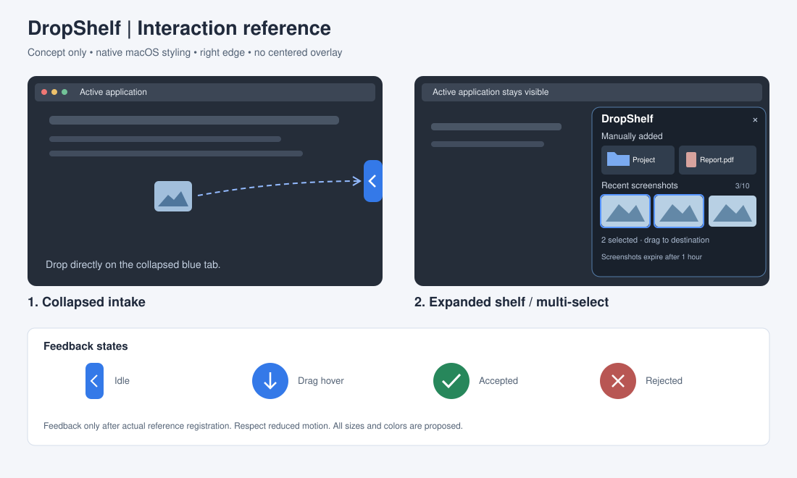

# DropShelf

A native macOS shelf for temporarily staging files, folders, and recent screenshots, then dragging them into another app.

Built with Swift and AppKit. Existing files remain in their original locations; the shelf keeps references in memory for the current session.

*Original design reference supplied with the project brief. This is a concept illustration, not a screenshot of the current build.*

## Features

- Blue floating tab at the right edge of the screen, accepting file drops while collapsed.
- Compact shelf with separate manual-file and recent-screenshot sections and image preview tiles.
- Native typed file-URL dragging, including multiple selected items, with copy-only operations.
- Cmd-click or long press for multi-selection, Cmd-A, Delete, Remove selected, and Clear all.
- Optional automatic screenshot collection from an explicitly selected save folder: newest 10 references, each expiring after one hour.
- Session-only state, no database, networking, telemetry, clipboard polling, or third-party runtime dependencies.

Removing or expiring a reference never deletes the original file. Clear all leaves screenshot monitoring enabled; use Stop to disable collection. Quitting starts the next session with an empty shelf.

## Build and run

The current project is named **SelfDrop**; the product is being developed as **DropShelf**.

1. Open `SelfDrop.xcodeproj` in Xcode.
2. Select the **SelfDrop** scheme and **My Mac** destination.
3. Build and run with **Command-R**. The current configuration uses local ad hoc signing, App Sandbox, and user-selected read-only file access.
4. Drop files onto the blue tab, then click it to open the shelf. Select tiles and drag them into a supported destination.
5. For automatic screenshots, click **Choose screenshot folder…** and choose the actual macOS screenshot save location. Save a new screenshot after enabling collection.

The project was built with the macOS 27.2 SDK and has a macOS 27.2 deployment target. It was checked on an Apple Silicon Mac running macOS 27.2.1. Compatibility with earlier systems is not established.

Screenshot collection uses directory-change notifications and macOS screenshot metadata. It does not import old screenshots, capture the screen, or accept clipboard-only image data/file promises. Metadata delays or missing metadata can prevent automatic collection; manual file drops remain available. Collection is bounded to a single nonrecursive folder with at most 4,096 entries and bounded candidate retries. Choose the folder again after restarting the app.

## Create a local DMG

Run `bash scripts/create-dmg.sh`. This builds Release, creates a compressed disk image in `dist/`, verifies it, mounts it read-only to check the app signature and Applications shortcut, and writes a SHA-256 checksum. Build output stays outside version control. The unused starter `ContentView.swift` is excluded from compilation; the application uses AppKit.

The DMG contains `DropShelf.app` (the internal executable remains `SelfDrop`) and installation notes. This is an ad hoc signed development package, without Developer ID signing or notarization. Gatekeeper acceptance on other Macs is not guaranteed. Packaging does not establish release acceptance or the 100 MB budget.

## Tests and verification

Select the **SelfDropTests** scheme and use **Command-U**. The hostless Swift Testing target compiles the production store source through a relative symlink; keep that symlink intact when checking out the repository.

Latest recorded checks:

- App build passed.
- Seven Swift Testing tests passed, covering reference deduplication/capacity, stale-result protection, drag snapshots, missing files, screenshot FIFO, expiry boundaries, promotion, and clearing.
- A synthetic directory-event check collected a newly metadata-marked fixture and excluded an old fixture and an unrelated PNG.
- The owner reported working transfers to VS Code, email, and ChatGPT in the earlier native-drag build. The redesigned UI and screenshot capture path still need physical-Mac integration checks.

This is a work in progress. Full-screen Spaces, multiple displays, accessibility, permission changes, actual screenshot capture, and the redesigned native drag UI still require manual verification. The 100 MB Release memory budget and idle CPU targets have **not** been validated. Do not treat passing unit tests as release acceptance.

See the [verification reports](verification/) for actual results and pending gates.

## Architecture

| Component | Responsibility |
|---|---|
| `SelfDropApp` | AppKit entry point and application lifecycle |
| `ShelfWindowController` | Floating nonactivating panel and right-edge placement |
| `FileDragView` | Native controls, tile selection, typed drag sessions, bounded previews |
| `ShelfStore` / `ReferenceResolver` | Main-actor session state, background reference checks, deduplication and expiry |
| `ScreenshotMonitor` | Event-driven observation and metadata classification in the selected folder |
| `SelfDropTests` | Foundation-only store and reference tests |

## Requirements and design

The full original specification is preserved in [DropShelf-Codex-Brief](SelfDrop/DropShelf-Codex-Brief/):

- [Engineering constraints](SelfDrop/DropShelf-Codex-Brief/AGENTS.md)
- [Requirements and architecture](SelfDrop/DropShelf-Codex-Brief/docs/)
- [Implementation plan](SelfDrop/DropShelf-Codex-Brief/docs/07-implementation-plan.md)
- [Original SVG wireframe](SelfDrop/DropShelf-Codex-Brief/design/shelf-wireframe.svg)

Changes should preserve native file semantics, session-only references, original-file safety, bounded background work, and honest verification results.
