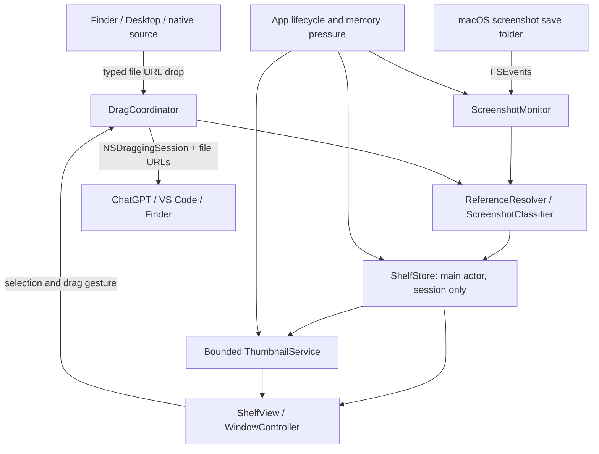

# System architecture

Use a single process, AppKit first; logical modules, not one class per box. Prefer simple value types and dependency injection only where useful for tests. No database, IPC service, backend or third-party package.

## Logical modules
- AppLifecycle: startup/shutdown, workspace sleep/wake, display/mount notifications, cancellation/cleanup. AppKit delegate or template bridge.
- WindowController: nonactivating floating panel when possible, right-edge placement, collapsed/expanded state, Space/display compatibility. Keep real drag source alive through session.
- ShelfStore (@MainActor): authoritative session-only state, manual items + screenshot queue, UUID-based selection, deduplication and atomic mutations. No second authoritative copy in view.
- ReferenceResolver: validate file URLs, optional in-memory bookmark, identity and availability. Background bounded IO; typed results applied only if item/generation still current. Do not follow recursive directories.
- DragCoordinator: native destination and source callbacks, accepted operation masks, typed payload, drag context snapshot, errors and lifetime. Does not upload files itself.
- ScreenshotMonitor/Classifier: FSEvents, coalesced rescans, classification, bounded retry, queue insertion; user-selected folder and explicit enablement/permission.
- ThumbnailService: lazy native icons/downsized previews, bounded cache/tasks; release on pressure and collapse as needed.
- ClipboardHandler (optional): explicit user actions only, no continuous observer; separate from native drag semantics.
- Diagnostics: OSLog with redacted paths/content, debug counters, profiling. No telemetry.

## Conceptual model (not prescribed code)
`ShelfItem`: UUID, file URL, optional in-memory bookmark data, file identity if available, display name, kind, origin (manual/automaticScreenshot), addedAt, optional capture timestamp, expiresAt, availability (available/unavailable/checking), generation. Store no full images or file contents. Selection Set<UUID>. `DragContext`: immutable ordered item snapshot, session token, required scoped-access handles. Release on terminal callback. Use a bounded screenshot array (10); no custom queue infrastructure necessary. Dedup by file resource identity plus volume where obtainable, standardized URL fallback, never content hash large files. Do not merge distinct paths incorrectly. Explicit manual staging of an auto screenshot may promote it to manual or preserve a separate membership; default promote to manual and remove auto entry (proposed).

## State / flows
Intake: hover -> inspect supported payload -> validate -> register accepted references -> feedback -> idle. Rejected/cancelled: no success indication. Partial acceptance must be visible. Validation must not hang UI; use checking/pending state for slow sources, return appropriate native acceptance only if staging can be supported. Do not conflate pending with successful registration.

Outgoing: select -> resolve/revalidate -> native drag with stable ordered snapshot -> terminal operation/cancellation -> release resources, maintain entries. No success claim for upload completion, because drag-end reports only OS operation. If subset unavailable, proposed default warn and allow valid subset only with explicit clear indication before dragging; never silently omit files. Guard active snapshot from TTL/eviction; evict shelf membership on schedule but keep session handles until drag ends. Do not touch original file.

Expiration: prune per item at now >= expiry; schedule one next-expiry timer only while needed; prune on wake/open/add/drag; handle clock changes. Enforce max 10 on each batch; dedup repeated OS events. Prefer actual capture/creation ordering if reliable; otherwise discovery timestamp and document fallback. No import of historic screenshots on startup.

Concurrency: main actor owns UI and state; background service for expensive IO/thumbnail work with explicit small concurrency and bounded pending work; cancellation and generation tokens prevent stale callbacks resurrecting removed items. Coalesce burst events; when queue overflows request bounded reconciliation, not silent loss. Do not block AppKit drag callbacks on remote IO. Validate when item enters shelf and use fresh cheap state at gesture; for slow checks show pending and let user retry. All external notification handlers marshal to correct actor. Teardown observers, event streams, timers, tasks, file descriptors and security scopes exactly once.
